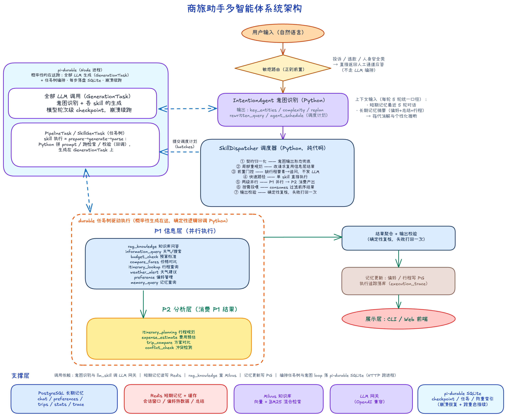

# 关键代码说明



## 技术栈

FastAPI · AgentScope · pi-durable · PostgreSQL · Redis · Milvus · CP-SAT · Harness Engineering· DAG· Skill Workflow· Memory Engineering· RAG · 模型评测

## 一、整体流程（系统架构）

一次问答的完整路径：

1. **用户输入** → 敏感路由前置检查（正则，投诉/退款/人身安全类直接返回人工通道，不走 LLM）
2. **IntentionAgent（意图识别，Python）**：拼好完整 prompt（时间锚点 + 长期记忆摘要 + 短期记忆最近 5 轮），提交给 pi-durable 的 GenerationTask 调 LLM；Python 拿回文本解析出结构化决策: `key_entities`（行程要素，含日期规范化）、`complexity`（simple/standard）、`replan`（是否修改类请求）、`agent_schedule`（调度计划）与 `rewritten_query`（指代消解后的查询）
3. **SkillDispatcher（调度器，Python）**：局部重规划判定（修改类请求复用上轮信息层结果，只重跑分析层）→ 前置条件门控（规划类请求缺关键要素→拦截追问，不发 LLM）→ 快速路径 / 两级分批 → 把调度计划提交给 pi-durable 的任务树
4. **P1 信息层（8 个 skill 并行）**：在 pi-durable 任务树（PipelineTask→SkillGenTask）上分批执行，每个 skill 的执行是三段循环——prepare（Python 拼 prompt：占位符替换/记忆取数/consumes 过滤）→ generate（pi-durable 的 GenerationTask 调 LLM）→ parse（Python 解析文本 + 契约归一化 + 确定性校验，校验不过则带回缺陷重生成）：rag_knowledge / information_query / budget_check / compare_fares / itinerary_lookup / weather_alert / preference / memory_query
5. **P2 分析层（消费 P1 结果）**：同一任务树上 P1 全部完成后自动进入：itinerary_planning（三段式：LLM 提取约束→排程求解器→LLM 叙述）/ expense_estimate / trip_compare / conflict_check
6. **输出链**：输出契约归一化 → 确定性校验（失败带原因打回一次）→ 结果聚合 → 记忆更新（偏好/行程写 PG）+ 执行追踪落库
7. **展示层**：CLI 或 Web 前端（

入口：`cli.py` 的 `process_query()` 与 `server.py` 的 `/chat`.

整条链路的分工原则是「概率性的在 pi-durable，确定性的在 Python」：意图识别与各 skill 的 LLM 生成跑在 pi-durable 的 GenerationTask 上（模型轮次级 checkpoint）；拼 prompt、检索、求解、校验、记忆、聚合这些确定性逻辑全在 Python。pi-durable 不可用时整链自动降级为纯 Python 本地路径，功能不变。详见第五节。

模型之外的一切工程化约束——调度编排、门控、契约归一化、确定性校验、敏感路由、执行追踪——统称 **Harness**（Agent = 模型 + Harness，模型只管生成，其余全是 Harness 的事）。全景见第八章开头的组件表。

---

## 二、入口与配置

### 2.1 `cli.py` / `server.py`

- **双入口同流程**：CLI（Rich 交互）与 FastAPI（Web）都执行完整链路；server 按 user_id 隔离编排链（`_UserPipeline`），按 session_id 切换会话（`switch_session` 重建短期记忆绑定，并从执行日志恢复该会话的重规划缓存）。回放端点 `GET /users/{uid}/chats` 的 assistant 消息在纯文本外附带结构化 `itinerary` 与确定性 `dataKey`（会话 ID+行号），历史消息的可视化卡片按各自 key 指向自己那轮的数据。
- `/chat` **幂等守卫**（`utils/idempotency.py`）：双击发送、网络重试这类重复提交不重跑流水线。幂等键取请求的 `request_id`（缺省用 会话+消息内容哈希 兜底），守卫三态: 首次占键执行；已有完成结果直接回放缓存响应；在途则等它完成后回放同一结果；失败释放键允许真正重试。Redis 优先（跨重启生效），降级进程内存；守卫自身故障就放行。
- **模型创建**：

```python
model = OpenAIChatModel(
    model_name=LLM_CONFIG["model_name"], api_key=LLM_CONFIG["api_key"],
    client_kwargs={"base_url": LLM_CONFIG["base_url"], "timeout": 60.0},
    generate_kwargs={"temperature": 0.7, "max_tokens": 16384},
)
```

### 2.2 `config.py`

七个配置块：`LLM_CONFIG`（模型）、`SYSTEM_CONFIG`（LLM 开关/日志级别/超时）、`RAG_CONFIG`（嵌入模型路径）、`RESILIENCE_CONFIG`（熔断/重试）、`PI_DURABLE_CONFIG`（pi-durable 服务开关/地址/令牌/超时预算）、`POSTGRES_CONFIG`（长期记忆）、`REDIS_CONFIG`（短期记忆+缓存，6380 端口）。

---

## 三、意图识别与编排

### 3.1 `agents/intention_agent.py`（IntentionAgent）

**职责**：把一句话变成一份完整的调度计划。单次 LLM 调用，输出直接决定后续所有 skill 怎么跑。

**Prompt 的组装**（`reply()` 内，按注入顺序）：

- **当前时间**：解析「下周三」「3月11日」这类相对/省略日期的锚点。日期规范化（相对时间→完整 YYYY-MM-DD 的 key_entities 字段）只在意图识别做，下游 skill 拿到的 `start_date` 都是完整日期
- **对话历史**：入口层传入的最近 5 轮 + 长期记忆摘要（system 消息），「这个标准是多少」的指代消解依赖这里
- **Skill 元数据**：`SkillLoader` 动态读取 `skills/` 下所有 SKILL.md 的 frontmatter: Progressive Disclosure 的第一层：LLM 只看到「有哪些能力、什么时候触发」（name + description），看不到执行细节。新增 skill 无需改这个文件，元数据自动进 prompt
- **意图区分规则**：同类词不同语境的处理（举个例子：「我去过北京吗」→ memory_query；「北京怎么样」→ information_query；「我想去北京」→ itinerary_planning）

**输出协议**（调度器消费的完整字段）：

```json
{
  "reasoning": "推理过程",
  "intents": [{"type": "itinerary_planning", "reason": "..."}],
  "key_entities": {
    "origin": "北京", "destination": "杭州",
    "start_date": "2027-03-20", "end_date": null, "duration_days": 3,
    "return_location": null, "trip_purpose": "出差"
  },
  "rewritten_query": "出差住宿标准是多少？",
  "missing_info": ["start_date"],
  "complexity": "simple",
  "replan": false,
  "agent_schedule": [
    {"agent_name": "rag_knowledge", "priority": 1, "reason": "...", "expected_output": "..."}
  ]
}
```

其中三个字段直接驱动调度器的机制分支：`complexity` 决定走不走快速路径、`replan` 决定是否复用上轮结果、`agent_schedule` 是执行清单本体。

**失败兜底**：LLM 输出解析失败时（剥围栏后直接 `json.loads`，再失败按花括号区间提取，两层都失败），返回默认调度: rag_knowledge 单 skill。选它是因为本地向量库检索不依赖 LLM 再调用，政策类问题命中率也最高：

```python
except Exception as e:
    logger.error(f"Intent recognition failed: {e}")
    result = {
        "intents": [{"type": "rag_knowledge", ...}],
        "rewritten_query": user_query,
        "complexity": "simple",
        "agent_schedule": [{"agent_name": "rag_knowledge", "priority": 1, ...}]
    }
```

### 3.2 `agents/skill_dispatcher.py`（SkillDispatcher）

调度器消费意图识别的调度计划，**确定性执行全部 skill（自身不调用 LLM）**。`reply()` 按序执行以下机制（架构图中调度器框内即此清单）：

| #   | 机制       | 一句话                     |
| --- | -------- | ----------------------- |
| ①   | 契约归一化    | 意图输出形态兜底（null 字符串/非法枚举） |
| ②   | 局部重规划    | 修改类请求复用上轮信息层结果，只重跑分析层   |
| ③   | 前置门控     | 规划缺行程要素→拦截追问，不发 LLM     |
| ④   | 快速路径     | 简单问题单 skill 直接执行        |
| ⑤   | 两级并行     | P1 并行 → P2 消费产出         |
| ⑥   | 按需投喂     | consumes 过滤前序结果         |
| ⑦   | 输出校验     | 确定性复核，失败带原因打回一次         |
| ⑧⑨⑩ | 聚合/落库/追踪 | 结果聚合、记忆写回、执行追踪          |

#### 3.2.1 意图输出契约归一化

```python
# 意图输出契约归一化（null 字符串/非法枚举/形态兜底）
intention_data = normalize_intention(intention_data)
```

LLM 输出不可全信：`"start_date": "null"`（字符串）需要归为 None、`complexity: "complex"`（非法枚举）需要归为 standard、`agent_schedule` 可能不是 list。`normalize_intention`（`utils/contracts.py`）在数据进入业务逻辑前统一完成这些修正，后续所有机制不用再各自防御。

#### 3.2.2 局部重规划（修改类请求的省钱机制）

用户说「换成希尔顿，重新规划」时，意图识别会标 `replan=true`。`_apply_replan` 的剔除逻辑：

```python
def _apply_replan(self, sorted_schedule):
    has_p2 = any(t.get("priority", 1) > 1 for t in sorted_schedule)
    if not has_p2:
        return [], sorted_schedule  # 没有 P2 时不存在"复用给谁"的问题，全量跑

    reused_results, remaining = [], []
    for task in sorted_schedule:
        name = task.get("agent_name", "")
        # 剔除条件：信息类（priority=1）且上一轮同名 agent 结果为 success
        if task.get("priority", 1) == 1 and name in self._last_results:
            cached = self._last_results[name]
            if cached.get("status") == "success"):
                reused_results.append({...})
                continue
        remaining.append(task)
    return reused_results, remaining
```

三条保守规则：纯信息类调度不剔除（它们可能就是用户要的答案）；上轮失败的不复用；判定权完全在意图识别: 它不给 `replan` 标记就全量重跑，误判的代价只是多跑几个 skill。被剔除的 P1 结果在执行开始前就并入 `results`: P2 批次执行时它们已在 `previous_results` 里（分析层只重跑也拿得到上轮信息层产出），同时进入最终聚合。

`_last_results` 缓存并不只活在进程内存里：每个 skill 执行成功时其完整结果已作为 `payload` 落入 `execution_trace`（见 3.2.9），进程重启或切换会话后，调度器通过 `restore_last_results(session_id)` 从追踪日志恢复该会话最近一轮的全部成功结果: 重启后用户说「换成希尔顿重新规划」，依然只重跑分析层。恢复只在内存缓存为空时进行，进程内已有更新的轮次时不覆盖；恢复失败静默（它是优化不是依赖）。

#### 3.2.3 前置条件门控

「帮我规划去杭州的行程」没说天数和日期: 这类请求直接跑 itinerary_planning 会得到一个编造日期的行程。门控在发 LLM 之前拦截：

```python
_GATED_AGENTS = {"itinerary_planning", "expense_estimate", "conflict_check", "trip_compare"}
_REQUIRED_FIELDS = {
    "itinerary_planning": ["destination", "duration_days", "start_date"],
    "expense_estimate": ["destination", "duration_days"],
    "conflict_check": ["destination", "start_date", "end_date"],
    "trip_compare": ["destination"],
}

def _check_preconditions(self, intention_data, sorted_schedule):
    # 以 key_entities 实际值为准（LLM 忘标 missing_info 也拦、误标但有值也放行）
    for name in gated:
        for f in self._REQUIRED_FIELDS.get(name, []):
            v = ke.get(f)
            if (v is None or (isinstance(v, str) and (not v.strip() or v.strip().lower() == "null"))):
                missing.append(f)
    # end_date 可由 start_date + duration_days 推算，不单独拦
    # origin 缺失可由家庭住址推断，不拦（单城行程也合法）
    return {
        "status": "needs_input",
        "missing_info": missing,
        "message": "规划前需要确认以下信息，补充后我马上继续：\n" + hints,
    }
```

返回的 `needs_input` 结构由展示层渲染成追问。用户补充「去3天，10月20日出发」后，意图识别从短期记忆的 5 轮上下文里解析出完整要素，下一轮正常续跑。

#### 3.2.4 快速路径（简单问题的捷径）

```python
if (complexity == "simple" and len(sorted_schedule) == 1
        and not self._get_consumes(sorted_schedule[0].get("agent_name", ""))):
    task = sorted_schedule[0]
    self._fast_path_used = True
    result = await self._execute_agent(
        agent_name=task.get("agent_name"), context=context, ...)
```

「出差住宿标准是多少」只需要一个 skill: 三重判定（意图识别判 simple + 调度只有 1 个 + 无 consumes 依赖）全满足时，跳过批次分组/聚合的中间管理层直接执行。**skill 本身照常跑**（质检、追踪、记忆落库都在），省的只是中间结构。任何一条不满足就落回标准路径。

#### 3.2.5 两级并行调度

```python
# 按 priority 分组，同组 gather 并行
for task in sorted_schedule:
    priority = task.get("priority", 0)
    if current_priority is not None and priority != current_priority:
        batch_results = await self._execute_parallel_agents(parallel_tasks, context, results)
        results.extend(batch_results)
        parallel_tasks = []
    current_priority = priority
    parallel_tasks.append(task)
```

`_execute_parallel_agents` 内部用 `asyncio.gather` 同批并发。P1 八个信息类 skill 同时跑；跑完把全部产出（`results`）作为 `previous_results` 传给 P2 批次: P2 的消费入口在 3.2.6。

#### 3.2.6 consumes 按需投喂

```python
# _execute_agent 内部，投喂前过滤
filtered_prev = self._filter_previous_results(agent_name, previous_results)

def _filter_previous_results(self, agent_name, previous_results):
    consumes = self._get_consumes(agent_name)  # 读 SKILL.md frontmatter
    if not consumes or consumes == ["*"]:
        return previous_results
    return [r for r in previous_results if r.get("agent_name") in consumes]
```

P2 收到的仅是它声明消费的部分：比如expense-estimate 的 SKILL.md 写 `consumes: [budget_check, rag_knowledge, information_query]`，memory_query 的产出就被滤掉。控制长上下文下的信息密度，也是 skill 间依赖的显式声明。

#### 3.2.7 输出契约 + 确定性校验

**校验器为两条执行路径共用**（pi-durable 路径在 `/parse` 回调端点里跑、本地路径在 `_execute_agent` 返回路径上跑，同一套 `evaluator.py`）：

```python
# 输出契约归一化（budget 数字字段兜底）
if agent_name == "budget_check":
    result = normalize_budget_result(result) or result

# 确定性校验（毫秒级）→ 失败带缺陷原因有界重试一次
if agent_name in ("expense_estimate", "conflict_check"):
    async def _exec_with_fix(issues):
        """首次复用已执行的输出；重试时把校验缺陷拼进 reason 让 LLM 修正重算"""
        if not _first["used"]:
            _first["used"] = True
            return result
        retry_payload["reason"] = (
            (reason or "") + "\n【上次输出未通过确定性校验，以下问题必须修正】\n"
            + "\n".join(f"- {i}" for i in issues)).strip()
    result, _v = await verified_execute(_exec_with_fix, verify_fn)
```

校验器（`utils/evaluator.py`）是纯代码：费用预估查「上限 = 住宿 + 餐饮」「分项之和 ≈ 合计」「超支标记与数字一致」；冲突检测用日期区间自证「标了 no_conflict 就不该有区间重叠」。失败时把具体缺陷（如「预算上限算术不符：800 + 690 ≠ 1000」）拼进重试 prompt 让 LLM 修正，仍失败则带 ⚠️ 标注放行。

pi-durable 路径下的对应实现：校验在 `/parse` 回调端点里执行，发现缺陷时返回 retry prompt，由 SkillGenTask 开新 stage 重新生成（见第五节）。两条路径的校验规则完全一致。

#### 3.2.8 聚合与记忆更新

```python
final_result = self._aggregate_results(results, intention_data)
if self.memory_manager:
    self._update_memory(intention_data, results)
```

聚合产出统一结构（`results` 列表 + `fast_path` 标记），展示层按 agent_name 分支渲染。`_update_memory` 两个落库路径：

- **preference**：输出先过 `normalize_preferences` 契约（嵌套列表展平、标量/列表形态互转），再做服务端确定性合并: `append` 时 value 是增量，与现有列表合并去重；`replace` 时 value 即最终值。合并不依赖 LLM 输出完整列表。
- **itinerary_planning**：行程要素（origin/destination/日期）直接取意图识别的 `key_entities`，落 `trip_history` 表；保存前查重: 同目的地+同日期的重复请求（重试/重新问同一行程）不再落库。

#### 3.2.9 执行追踪

每个 skill 执行被计时闭包包裹，三个返回点（success/error/exception）都记录：

```python
def _trace(status: str, result_obj: Any):
    try:
        self.tracer.record(
            user_id=self._trace_ctx.get("user_id", ""),
            agent_name=agent_name, status=status,
            duration_ms=int((_time.monotonic() - _t0) * 1000),
            fast_path=self._fast_path_used,
            input_data={"reason": reason, "expected": expected_output,
                        "replay": self._get_replay(agent_name) or ""},
            output_data=result_obj,
            turn_id=self._trace_ctx.get("turn_id"),
            payload=result_obj if isinstance(result_obj, dict) else None,
        )
    except Exception:
        pass  # 追踪写入失败静默: 不能影响主流程
```

三个新字段的语义：`turn_id` 由入口层（CLI/server）每轮生成，同轮的意图识别与所有 skill 共享，把一轮对话的全部记录串起来；`payload` 是完整结果 JSON（区别于 `output_digest` 的 500 字摘要），是 3.2.2 局部重规划跨重启恢复的数据来源；`replay` 来自 SKILL.md frontmatter 声明（见第四章），标记该 skill 是否可安全重跑，作为崩溃恢复策略的依据记入日志。

---

## 四、 Skill 实现

### 4.1 `utils/skill_runners.py` + `agents/lazy_agent_registry.py`

Skill 通过 SKILL.md frontmatter 声明能力，执行逻辑由通用 runner 承载：

```yaml
# skills/expense-estimate/SKILL.md 的 frontmatter
---
name: expense-estimate
kind: llm_skill                         
consumes: [budget_check, rag_knowledge, information_query]   # 消费哪些 P1
replay: safe                             # 重放安全性：safe=只读可重跑 | unsafe=有副作用不重放
description: 触发条件与能力描述（注入意图识别 prompt）
---
```

`replay` 声明该 skill 崩溃后能否安全重跑：信息/分析类全部只读，标 `safe`；preference 写长期偏好（重放会重复写入），是唯一标 `unsafe` 的。调度器把它记入执行追踪，作为将来崩溃恢复策略的依据（safe 的重跑、unsafe 的不重放）。

- **LLMSkillAgent**：SKILL.md 正文即 prompt 模板，支持占位符替换: `{{user_query}} / {{key_entities}} / {{user_preferences}} / {{current_date}} / {{previous_results}} / {{trip_history}} / {{chat_summary}}`（后两个需 `need_memory: true`）。执行分为三个可独立调用的方法（与 pi-durable 的三段循环一一对应）：

```python
async def prepare_prompt(self, data) -> str | {"_error": ...}:
    # 纯确定性：读 SKILL.md 正文 + frontmatter，占位符逐个替换
    # （含 need_memory 的行程历史/会话摘要取数），超长（>60K 字符）直接拒绝

def parse_output(self, text: str) -> dict:
    # 纯确定性：四层 JSON 解析（剥围栏→修复裸换行→区间提取→raw_decode），
    # 失败兜底 {"status": "success", "answer": 原文本}: 宁可给纯文本也不丢内容

async def reply(self, x):
    # 本地降级路径：串联上面两段 + 中间 Python 直调 LLM
    prompt = await self.prepare_prompt(_parse_input(x))
    text = await _call_llm_text(self.model, [...])
    return self.parse_output(text)
```

pi-durable 路径下 `prepare_prompt`/`parse_output` 分别由 `/prepare`、`/parse` 回调端点调用（见第五节三段循环），LLM 调用发生在 generate 段；本地降级路径下 `reply` 一口气跑完。两条路共享同一份拼装与解析代码。

runner 的执行边界统一治理：`_call_llm_text` 整体包一层超时（配置值钳制到 30–600 秒），占位符替换后 prompt 超过 60K 字符直接拒绝执行：超长输入在烧掉一次 LLM 调用之前就失败，错误要早、要便宜。

- **LazyAgentRegistry**：扫描 `skills/` 目录，按 SKILL.md 声明实例化各 skill。懒加载 + 实例缓存: 首次调用才 import 模块/建实例，之后复用，skill 启动时只扫元数据不实例化，避免比如 ask-question 要加载 2.27GB BGE-m3 + 2.1GB reranker + 连 Milvus，消耗太多时间。
- **SkillLoader**（`utils/skill_loader.py`）：SKILL.md 的统一读取器——frontmatter 解析（yaml）供三个消费方：意图识别的 prompt（只取 name+description，`get_skill_prompt`）、runner 的执行模板（`get_skill_content` 取正文）、调度器的 consumes/replay 判定。另维护 `DISPATCH_ALIASES` 调度名→目录名映射表（`itinerary_planning`→`plan-trip` 这类历史命名差异），注册表与编排器共用这一份，避免各自维护漂移。
- **新增一个 llm_skill = 写一个 SKILL.md 文件，零 Python**。

---

## 五、pi-durable 编排底座（双运行时架构）

### 5.1 Python 和 pi-durable 的分工

整个系统是双运行时：Python（FastAPI）+ pi-durable（Node 服务，`services/pi-durable/`，`@earendil-works/pi-durable@1.3.0`）。分工原则一句话：**「概率性的（LLM 生成）在 pi-durable，确定性的（检索/求解/校验/记忆/编排规则）在 Python」**

| 职责                                | Python（FastAPI）                            | pi-durable（Node 服务）                         |
| --------------------------------- | ------------------------------------------ | ------------------------------------------- |
| 意图识别：拼 prompt                     | ✅（时间锚点/系统记忆/5轮历史/SKILL 元数据，`build_prompt`） | ❌                                           |
| 意图识别：LLM 调用                       | 只做解析与兜底                                    | ✅ GenerationTask                            |
| 编排决策（门控/重规划/快速路径/分批）              | ✅ `plan_batches`                           | ❌                                           |
| 编排执行（任务树运转/两级并行/落盘/恢复）            | ❌                                          | ✅ PipelineTask                              |
| skill：拼 prompt（含记忆取数/consumes 过滤） | ✅（prepare 端点）                              | ❌                                           |
| skill：LLM 生成                      | ❌                                          | ✅ GenerationTask（prepare→generate→parse 循环） |
| skill：解析/契约归一化/确定性校验              | ✅（parse 端点，校验不过带回缺陷重试）                     | ❌                                           |
| 检索 / 排程求解器 / 外部工具（天气/搜索）          | ✅ 全部                                       | ❌                                           |
| 记忆（Redis 短期 / PG 长期）              | ✅ 全部                                       | ❌                                           |
| 结果聚合 + 落库副作用                      | ✅ `finalize_turn`/`_update_memory`         | ❌                                           |
| 幂等防重                              | 第一层（快速回放完整响应）                              | 第二层（跨重启接续在途任务）                              |
| 崩溃恢复                              | 降级路径（PG 追踪日志恢复）                            | ✅ 主路径（SQLite checkpoint 自动续跑）               |
| 自己持久化什么                           | PG（聊天/行程/偏好/trace）                         | SQLite（checkpoint/任务/submission）            |

表里 pi-durable 一侧出现两种任务，区分标准不是「哪个环节」而是「活是算的还是问的」：**PipelineTask 是执行骨架**（分批/等待/收集，全程不调 LLM），**GenerationTask 是 LLM 调用本身**（意图识别的一次调用 + 每个 skill 生成时的一次调用）。编排执行那行指的是前者；意图识别和 skill 生成的 LLM 调用行都是后者。

**双路并存**：pi-durable 可用走上面的任务链；不可用自动降级纯 Python 本地路径（Python 里保留完整的一套本地 LLM 调用与编排实现）: 对外功能完全一致。

### 5.2 pi-durable 上跑什么：两类任务，为什么不一样

pi-durable 里注册着两种任务，分别对应流程里两种性质完全不同的工作：

- **PipelineTask（编排）**——回答「这轮要跑哪些 skill、按什么顺序跑」。这是**确定性**的：跑什么、怎么分批，全部由 Python 的调度决策提前定死，pi-durable 只负责照章执行、记录进度、崩了从断点继续。它自己不调 LLM。
- **GenerationTask（生成）**——回答「这次 LLM 该输出什么」。这是**概率性**的：同一个 prompt 每次调用结果都不同，且调用耗时数十秒、中途可能超时或崩溃，所以需要模型轮次级的 checkpoint（流式输出每 100ms 落盘一次）。

#### 编排链路（PipelineTask）

Python 决定好分批计划后提交给 pi-durable，之后整批执行都由任务树驱动：

```python
# utils/durable_turn.py —— Python 侧：把分批计划打包提交
payload = {"request_id": rid, "batches": batches, "context": context, ...}
submitted = await client.submit_turn(payload)      # POST /v1/pipeline/submit
result = await client.wait_turn(submitted["task_id"])  # 长轮询等整轮完成
```

```typescript
// services/pi-durable/src/tasks/pipeline.ts —— dispatch 相位：建本批子任务并进入等待
await runtime.commit(async (tx) => {
  const ids: TaskId[] = [];
  for (const entry of batch) {
    ids.push(await tx.createTask(SkillGenTask, {...}, { ownership: { kind: "task", taskId: task.id } }));
  }
  return { status: "waiting", checkpoint: {...}, on: ids, policy: "allSettled" };  // 本批全完成才醒
}, ctx);
```

`waiting(allSettled)` 是关键：本批调度了几个 skill 就并行跑几个（本轮计划只要 1 个就跑 1 个），全部结束才唤醒 collect 相位进入下一批——**并行的编排结构被持久化成任务等待关系**，进程崩溃重启后从断点批次继续，已完成的 skill 不重跑。

#### 生成链路（GenerationTask 与 skill 的三段循环）

每个 skill 的执行不是一个整体调用，而是拆成三段，**每段只干一类事**：

```typescript
// services/pi-durable/src/tasks/skill_gen.ts —— 三段循环的骨架
phases: {
  prepare: async (task, runtime, ctx) => {   // ① 决定要生成什么（确定性，回调 Python）
    const prep = await _py.callSkillPrepare(input);   // Python 拼好完整 prompt
    if (prep.action === "result") { /* 短路：无需 LLM，直接终态 */ }
    /* 否则带着 prompt 进入 generate 相位 */
  },
  generate: async (task, runtime, ctx) => {  // ② 调 LLM 生成（概率性，pi-durable 自己干）
    const conversation = await _skills.create();      // 全新短命 conversation
    const submission = await conversation.submit({ type: "input", content: prompt, requestId }, ctx);
    await submission.wait(ctx);                       // 等 LLM 输出（模型轮次级 checkpoint）
  },
  parse: async (task, runtime, ctx) => {     // ③ 检查生成结果（确定性，再回调 Python）
    const parsed = await _py.callSkillParse(input, text);  // 解析 JSON + 校验
    if (parsed.action === "retry") { /* 校验不过 → 带缺陷回 generate 重新生成 */ }
    /* 否则终态，结果交回 PipelineTask 聚合 */
  },
}
```

**为什么这样拆**：

- **prepare / parse 放 Python**：拼 prompt 要读 SKILL.md、查记忆、过滤前序结果；解析要容错抽 JSON、跑确定性校验——全是确定性逻辑，留在 Python 既自然又可单测。回调是毫秒级的。
- **generate 放 pi-durable**：这是唯一「问模型」的环节，也是最贵的环节。放在 GenerationTask 上意味着输出带 checkpoint（崩了不丢）、requestId 幂等（重试不双跑）、超时可观测。
- **循环而非一次成型**：parse 发现校验缺陷时返回 retry prompt，SkillGenTask 回到 generate 用修正后的提示重新生成——「生成 → 检查 → 重生成」的闭环天然用状态机表达，且每次重生成同样是持久化任务，崩了从当次生成续。

意图识别也走 GenerationTask（它是「只跑一次的三段循环」：Python 拼 prompt → `/v1/intent/submit` 提交 → GenerationTask 调 LLM → `/v1/intent/wait` 拿文本 → Python 解析），复用同一套 checkpoint 与幂等机制。

#### 可靠性机制（对上面两条链路统一生效）

**崩溃恢复**——pi-durable 每次启动时把上次没跑完的任务接着跑：

```typescript
// services/pi-durable/src/harness.ts —— 启动即续跑
const harness = await Harness.open(await openNodeSqliteStorage(config.storagePath), {...});
harness.resume();   // running 任务回写 pending：编排从批次断点续、生成从模型轮次续
```

```typescript
// services/pi-durable/src/index.ts —— 存储层致命错误时自杀，由进程管理器拉起后继续 resume
runtime.harness.closed.then((end) => {
  console.error("Harness session ended:", JSON.stringify(end));
  process.exit(1);
});
```

生成不重跑双份的保证：generate 段先落 checkpoint（conversationId + requestId）再 submit（`skill_gen.ts` 的幂等纪律）——崩溃重放该相位时，同 requestId 的提交直接返回既有 submission，LLM 不会执行第二次。

**requestId 三层去重**——同一请求无论发几次、无论哪个进程重启，都只执行一次：

```python
# 第①层 utils/idempotency.py —— Python 入口守卫：重复请求直接回放缓存响应
#   首次占键执行；done → 回放缓存；inflight → 等待后回放同一结果；失败释放键允许真重试
```

```typescript
// 第②层 services/pi-durable/src/server.ts —— submit 端点：同键重发返回已有任务
const index = await tx.doc(RequestIndex, root.id);        // root conversation 上的索引文档
const key = `${input.user_id}:${input.request_id}`;
const existing = index.entries[key];
if (existing) return { task_id: existing.taskId, duplicate: true };  // 跨重启接续
const taskId = await tx.createTask(PipelineTask, input, { ownership: { kind: "conversation" } });
index.entries[key] = { taskId: String(taskId), createdAt: Date.now() };
```

第③层：原请求彻底失败时释放键，让真正的重试能重新执行（在 `idempotency.py` 的 `release()`）。

**降级语义**——按「重跑有没有副作用」决定降还是拒，核心在客户端的返回约定：

```python
# utils/pi_durable_client.py —— 提交期故障返回 None（降级信号）
async def submit_turn(self, payload) -> Optional[dict]:
    try:
        resp = await self._http().post(f"{self.base_url}/v1/pipeline/submit", ...)
        ...
    except (httpx.HTTPError, ValueError) as e:
        logger.warning("pi-durable submit failed → 降级本地: %s", e)
        return None            # server.py 拿到 None → 走本地路径（orchestrator.reply）

# 提交成功后的故障绝不降级——任务可能还在 pi-durable 上跑，本地重跑=双执行
class PiDurableUnavailable(Exception):
    """上层应 503，不得降级本地重跑。"""
```

- 编排：提交期故障 → 降级本地；提交成功后故障 → 503「用相同 request_id 重发接续」
- 意图识别：幂等（同 prompt 同输出，重跑无害）→ 一切故障直接降级本地 `IntentionAgent.reply`
- 整个 pi-durable 不可用 → 全链降级纯 Python 本地路径，功能不变

**HTTP 协议与鉴权**——pi-durable 8788 端口；受保护路由校验 `X-Internal-Token`（`timingSafeEqual` 防时序侧信道，`server.ts`）；统一 `{code, message, data}` 信封。端点：`GET /health`（免鉴权探活）、`POST /v1/pipeline/submit|wait`（编排）、`POST /v1/intent/submit|wait`（意图）；Python 侧的 skill 回调 `POST /internal/skills/{name}/prepare|parse`（毫秒级，`server.py`）。

**配置**——`config.py` 的 `PI_DURABLE_CONFIG`（enabled/base_url 8788/令牌/超时预算），pi-durable 启动时从环境变量读模型配置（值与 `LLM_CONFIG` 同源，见 `providers.ts`）。**单 storage 单 Harness**：同一 `data/pi-durable/session.sqlite` 只允许一个 pi-durable 实例（`harness.ts` 头部注释的硬约束）。

一次 /chat 在 SQLite 里产生的任务：`pi.generation`（意图与 skill 的生成）+ `shanglv.pipeline` + 若干 `shanglv.skill.gen`——「LLM 调用都在 pi-durable 上」可以直接用任务表自证。

---

## 六、记忆系统

### 6.1 `context/memory_manager.py`（MemoryManager）

统一门面，两层记忆。两层各管一类信息，生命周期完全不同：

|                | 短期记忆                                             | 长期记忆                                                                                                                                          |
| -------------- | ------------------------------------------------ | --------------------------------------------------------------------------------------------------------------------------------------------- |
| **存什么**        | 本会话的对话原文（用户每句话、助手每个回答，按消息条存）                     | 跨会话的持久事实：**偏好**（住哪家品牌/坐哪家航司/靠窗——preferences 表）、**去过的行程**（何时去了哪、出差还是旅游——trip_history 表）、**全部聊天记录**（chat_history 表）、**统计**（出差次数等——user_stats 表） |
| **干嘛用**        | 让「这一会话内」的连续对话互相接得上——用户说「换个希尔顿」，得知道「换」的是上文提到的那个行程 | 让系统「认识你」：新会话开口就能推断（家庭住址可补出发地）、个性化（酒店偏好直接进规划）、行程规划查历史冲突、回答「我常去哪出差」                                                                             |
| **存哪**         | Redis List（快，但 1 小时过期）                           | PostgreSQL（永久）                                                                                                                                |
| **怎么进 prompt** | 最近 5 轮原文直接拼进意图识别的上下文                             | 偏好+历史行程摘要+LLM 总结压缩成一段 system 前置                                                                                                               |

**短期记忆**（`short_term_memory.py`）：Redis List + `ltrim` 滑动窗口（存储 10 轮，意图识别取最近 5 轮）+ TTL 1 小时，key 为 `shanglv:stm:{user_id}:{session_id}`（用户维度必须进 key，否则不同用户同名会话互串）。Redis 过期后从 PG `chat_history` 按会话 ID 降级读取——对话原文在 PG 永久留底，Redis 只是热缓存。写入是三步原子 pipeline：

```python
pipe = self.redis_client.pipeline()
pipe.rpush(key, json.dumps(message))         # 追加本轮消息
pipe.ltrim(key, -(self.max_turns * 2), -1)   # 滑动窗口裁剪（保留最近 10 轮）
pipe.expire(key, self.session_ttl)           # TTL 1 小时
pipe.execute()
```

Redis 不可用降级进程内存（接口不变，只丢跨进程共享）。

**长期记忆**（`long_term_memory.py`）：PG 四张表（chat_history / preferences / trip_history / user_stats），`CREATE TABLE IF NOT EXISTS` 首次自动建表；PG 不可用降级 JSON 文件。偏好读取走 `_CachedLongTermProxy`：读时先查 Redis（miss 则读 PG 并回填，TTL 24h），写时主动失效缓存：

```python
def get_preference(self, pref_type=None):
    cached = self._redis.get(self._pref_key)      # 命中直接返回
    if cached is not None:
        prefs = json.loads(cached)
        return prefs if pref_type is None else prefs.get(pref_type)
    result = self._long_term.get_preference(pref_type)  # miss → PG → 回填缓存
    self._redis.setex(self._pref_key, self._pref_ttl, json.dumps(result))
    return result
```

**LLM 会话总结缓存**：按「历史指纹」（消息数+末条内容哈希）缓存，历史不变才命中，防陈旧总结。

**上下文注入**：每轮意图识别收到 `system(长期摘要) + 最近5轮 + 当前输入`——长期摘要含偏好全量、LLM 总结（排除当前会话防自我污染）、按当前输入筛选的相关行程。

### 6.2 注入链路：谁拿到什么记忆

两层记忆只在**意图识别**汇合，下游 skill 拿的是「加工品」而非原文：

```
意图识别的输入：
  system  ← 长期摘要（偏好 + 历史行程 + 总结，压缩成一段）
  最近5轮 ← 短期记忆的对话原文
  当前输入

意图识别的输出：
  rewritten_query —— 已把上下文消化进去的查询
  （「这个标准是多少」+ 上文聊住宿 → rewritten_query = 「出差住宿标准是多少」）

skill 拿到的：只有 rewritten_query（+ 声明 need_memory 的 skill 额外拿到行程历史/总结）
```

这样设计的原因：意图识别需要**对话原文**做指代消解（「这个」指什么、「换一个」换什么，必须看上文才懂）；skill 是执行者，只需要一个**自包含的任务**——把消解后的 query 给它就够了，不用也不该把整段历史塞进每个 skill 的 prompt（上下文膨胀、且各 skill 会被无关轮次干扰）。

---

## 七、行程规划三段式（plan-trip）

### 7.1 `skills/plan-trip/script/agent.py` + `solver.py`

行程规划在 LLM 之间插入确定性求解步骤，实现位于 `script/agent.py`。三段式的衔接在 `reply()` 里：

```
①LLM 提取：读需求/偏好/预算标准 → constraints（天数/时段/预算/交通耗时）+ activities（8-15 候选，带时长/评分/门票/开放时段/是否必去/可选 lat-lng 坐标: 知名景点给大致坐标，求解器解提取时透传到行程输出供地图渲染）
②solver.solve_itinerary()：毫秒级约束求解（无 LLM），基于 Google OR-Tools 的 CP-SAT 约束规划求解器:
    硬约束：活动不重叠（含交通间隔）、每日上限、开放时段、门票≤预算、必去项必安排
    优化目标：优先安排评分高的活动（Maximize 加权评分）
③LLM 叙述：把求解排程写成行程文案（排程不可改动），补充怎么玩/怎么到/吃什么/住哪
```

```python
# 第①段：提取约束与活动池
text1 = await _call_llm_text(self.model, [{"role": "user", "content": extract_prompt}])
extract = _parse_llm_json(text1)
constraints = extract.get("constraints", {})
activities = extract.get("activities", [])

# 第②段：确定性求解（毫秒级，无 LLM）
solution = solve_itinerary(constraints, activities)
if solution.get("status") == "infeasible":    # 必去装不下 → 如实报告，不静默丢项
    return _reply(self.name, {"status": "success", "missing_info": [...],
                              "note": "行程无法在给定约束下排出..."})

# 第③段：求解结果拼进叙述 prompt（排程不可改动）
narrate_prompt = (narrate_part +
                  "\n\n【求解结果】（排程已经过时间冲突与预算校验，安排不可改动）\n"
                  + json.dumps(solution, ...) + "请按第③段要求输出最终行程 JSON。")
```

**CP-SAT 是什么**：约束规划（Constraint Programming）求解器——你把问题声明成「一组变量 + 变量必须满足的约束 + 一个想优化的目标」，它内部用组合搜索（约束传播剪枝 + 冲突驱动的子句学习）穷举出满足全部约束的最优解。和贪心/启发式的区别：它**证明**找到的解满足每条约束，找不到时报告 infeasible（无解），不会像启发式那样给出「差不多」的答案。排程问题（车间调度、课程表、行程规划）正是它的经典场景。

**变量模型**（把行程排程翻译成 CP-SAT 能解的形式——`ortools.sat.python.cp_model`）：每个活动两个决策变量：分到哪天（`day[i]`，必去项不允许取 -1 即「不安排」）和几点开始（`start[i]`，取值域由开放时段与每日窗口的交集决定）。每天的活动数上限用「同天布尔」求和约束表达：

```python
# solver.py 的建模实例（节选）
day.append(model.NewIntVar(0, days - 1))        # 必去：取值域不含 -1（必须安排）
b = [[model.NewBoolVar(f"b{i}_{d}") ...]]       # b[i][d]=1 表示活动 i 分到第 d 天
model.Add(day[i] == d).OnlyEnforceIf(b[i][d])   # 布尔与整数变量联动
model.Add(sum(b[i][d] for i in range(n)) <= max_per_day)   # 每天活动数上限
model.Maximize(weighted_sum(ratings))           # 优化目标：加权评分最大（必去 ×3）
```

**互斥顺序的实现**: 两个活动谁先谁后，用方向变量表达：

```python
order_ij = model.NewBoolVar(f"ord{i}_{j}")
model.Add(start[i] + activities[i]["_dur"] + travel <= start[j]) \
    .OnlyEnforceIf([same_day_ij, order_ij])          # order=1: i 在 j 前
model.Add(start[j] + activities[j]["_dur"] + travel <= start[i]) \
    .OnlyEnforceIf([same_day_ij, order_ij.Not()])    # order=0: j 在 i 前
```

`same_day_ij` 刻画「两者是否同天」（由每天的分配布尔变量组合而来），只有同天时才强制其中一个方向成立；`travel` 是活动间的平均交通时间。优化目标是最大化加权评分（必去项权重 ×3），预算约束把「是否安排」的布尔夫量乘上门票价格求和限制在上限内。

**为什么用求解器而不是让 LLM 排**：排程的每条约束都是可判定的数学条件（时间不重叠、预算不超），CP-SAT 毫秒级给出保证满足全部约束的解；LLM 排程要几十秒且经常编出重叠行程或超预算的方案（然后还要靠质量校验打回重来）。确定性计算交给确定性引擎，LLM 只做它擅长的两端（理解需求、写文案）——这就是三段式分层的出发点。

---

## 八、Harness：把模型圈在确定性围栏里

**Harness 是什么**：Agent = 模型 + Harness——模型之外的一切工程化设施都是 Harness。模型负责生成（意图识别的输出、skill 的回答、行程的文案），Harness 负责约束、校验、兜底、记录。这个项目里 Harness 不是某个单独的模块，而是贯穿全链路的一套约束体系：

| Harness 组件 | 实现                                                 | 所在章节 |
| ---------- | -------------------------------------------------- | ---- |
| 调度编排（DAG）  | 意图识别出调度计划 → 调度器确定性执行（模型只出计划，不执行）                   | 第三章  |
| 输入约束       | 前置门控（缺要素不开工）、超长输入拒绝、prompt 上限                      | 第三章  |
| 输出约束       | 契约归一化（字段形态兜底）——模型输出字段名漂移/形态错误统一修正                  | 8.2  |
| 质量校验       | 确定性校验器（算术/区间复核）失败打回重生成，行程五项检查                      | 8.1  |
| 敏感兜底       | 敏感前置路由（投诉/退款/人身安全不进 LLM，直接人工通道）                    | 8.3  |
| 可观测        | 执行追踪（每个 skill 的耗时/输入/输出/payload 落库）+ Prometheus 指标 | 8.4  |
| 连接稳定性      | LLM 调用重试退避 + 三态熔断（过载时快速失败防雪崩）                      | 8.5  |
| 持久化与恢复     | pi-durable 任务树（checkpoint/崩溃续跑/幂等）                 | 第五章  |
| 上下文工程      | 双层记忆注入 + rewritten_query 压缩                        | 第六章  |

本章介绍校验器、契约归一化、敏感路由、执行追踪，它们是 Harness 中直接和模型输出对抗的部分：模型会编造数字、会输出残缺 JSON、会对投诉用户说错话，这些可以通过代码在输出链路上拦住。

### 8.1 `utils/evaluator.py`（评估器 + 校验器）

**行程五项检查**（`evaluate_itinerary`，纯代码毫秒级）：

```python
# 硬性四项（任一不过 → verdict=failed）
1. 天数覆盖：key_entities.duration_days 与实际 daily_plans 数一致
2. 必去项覆盖：用户点名的地点出现在行程文本中
3. 预算合规：行程内活动花费合计 ≤ 上限
4. 时间无重叠：同日活动两两间隔 ≥ 30 分钟（逐日解析 "09:00-12:00" 格式核对）
# 软性一项（缺失只提示）
5. 偏好体现：用户酒店/航司偏好被提及（verdict=warning，仍放行）
```

plan-trip 输出后自动过检，failed 携具体缺陷原因（如「行程天数不符：要求 3 天，实际 2 天」）打回重生成一次，仍失败放行+⚠️ 标注。

**确定性校验器**（`verify_expense_estimate` / `verify_conflict_check`）：

```python
# 费用预估的三条算术规则
- budget_cap.total == accommodation + meals          # 上限自身加法
- estimate 各分项区间之和 ≈ total 区间（±10% 容差）   # 分项与合计
- over_budget 单向一致性：标了超支但数字不支持才报     #（未标但实际超支不在此查，由内容验收兜底）

# 冲突检测的区间自证
- result == "no_conflict" 时，checked_trip 区间与 trips 里任一未来行程都不相交
  （过去的行程记录不算冲突: 与 skill 规则一致，不误报）
```

### 8.2 `utils/contracts.py`（输出契约归一化）

LLM 输出的字段名漂移、形态错误统一兜底，四个归一化函数各管一路数据：

```python
normalize_intention(...)       # 意图输出：字符串 "null"→None、complexity 非法枚举→standard、
                               # replan 强转布尔、agent_schedule 非 list→空
normalize_preferences(...)     # 偏好输出：嵌套列表 [["万豪","希尔顿"]] 展平、
                               # 标量型偏好收数组降首个、列表型偏好收标量升列表、空值剔除
normalize_itinerary_result(...)  # 行程输出：剥 stage 标记、activities 形态兜底
normalize_budget_result(...)     # 预算输出："400元" 等字符串数字转 int
```

契约层在数据进入业务逻辑前统一完成形态修正: 调用方拿到的永远是合法结构。

### 8.3 `utils/sensitive_router.py`（敏感前置路由）

**为什么前置**：投诉/退款/人身安全类的请求如果放给 LLM 编排，会被路由到 rag_knowledge 答一段政策条文——答非所问；这类请求真正需要的是人工通道。确定性规则在这件事上比 LLM 路由可靠，所以在意图识别**之前**拦：

```python
# utils/sensitive_router.py —— 三类规则：正则 + 固定应答
_RULES = [
    ("personal_safety", re.compile(r"(人身安全|被威胁|遇到危险|报警|急救|救护车|拨打\s*1[12]0|打\s*1[12]0)"),
     "您描述的情况涉及人身安全，请**立即拨打 110（报警）或 120（急救）**..."),
    ("complaint", re.compile(r"(投诉|举报|起诉|欺骗|欺诈|退款不|不给退)"),
     "您的诉求涉及投诉/退款，需要人工客服处理：差旅平台客服 400-800-8888..."),
    ("refund", re.compile(r"(退款|退钱|扣款错误|重复扣款|多扣了)"),
     "涉及资金/退款处理，请通过人工通道解决..."),
]

def check_sensitive_request(user_input: str) -> Optional[Dict]:
    # 命中任意一条 → 返回 {category, 固定应答}；否则 None 走正常流程
    for category, pattern, response in _RULES:
        if pattern.search(text):
            return {"sensitive": True, "category": category, "response": response}
    return None
```

CLI 与 server 入口在进入意图识别前调用（`server.py` 的 `_chat_execute` 开头）；命中直接返回人工通道应答，**不进 LLM、不进编排**。两个防误伤设计：数字类关键词必须带「拨打/打」语境才触发（`拨打\s*1[12]0`——「预算 1200 元」不会误拦）；退款应答里明确提示「如果只是想了解退款政策，换个说法我可以帮您查」——把「要退款」和「查退款政策」分开。

### 8.4 `utils/execution_tracer.py`（执行追踪）

每次 skill 执行 + 意图识别各落一条 PG `execution_trace`（agent/status/duration_ms/fast_path/turn_id/input·output 摘要/payload 完整结果）；写入失败静默；PG 不可用降级内存环形缓冲（500 条）。查询端点 `GET /users/{uid}/trace`（明细）与 `/trace/stats`（各 skill 调用次数/平均耗时/P95/失败率）。

`latest_turn_results(session_id)` 取该会话**最后一个带 payload 的轮**的全部 success 结果，供调度器跨重启恢复 `_last_results`（3.2.2 局部重规划的数据来源）: 执行追踪因此不只是运维指标，也是结果日志。建表语句带平滑迁移（旧库 `ADD COLUMN IF NOT EXISTS` 补列），顺序为 建表→旧列索引→补列→引用新列的索引（最后一步若先于补列执行，整个初始化会失败）。

**Prometheus 埋点**（`utils/metrics.py`，`GET /metrics` 暴露标准文本格式）：`query_total`（按 intent 分桶）、`query_latency_seconds`（端到端直方图）、`skill_total`（按 agent/status）、`fastpath_total`、`requests_in_flight`（并发 Gauge）。埋在 `/chat` 的入口与正常/敏感两个出口。

### 8.5 `utils/circuit_breaker.py` + `utils/llm_resilience.py`（LLM 稳定性）

模型网关会抖（超时/限流 429/5xx），两条主线调用（意图识别、编排）都包着同一套韧性设施：

```python
# circuit_breaker.py —— 三态熔断：连续失败 N 次后打开（拒绝调用，直接 503 降级），
# 冷却一段时间后半开（试探性放行少量请求），半开成功 M 次后关闭恢复正常
CLOSED = "closed"      # 正常调用
OPEN = "open"          # 拒绝调用，直接降级
HALF_OPEN = "half_open"  # 试探性放行

# llm_resilience.py —— 带指数退避的重试（只重试可重试错误：网络/超时/429 限流/5xx）
orchestration_result = await retry_with_backoff(
    lambda: pipeline.orchestrator.reply(intention_result),
    max_retries=3, base_delay_sec=1.0, max_delay_sec=30.0,  # 1s→2s→4s 指数退避
)
```

两者配合：单次失败走重试退避（`retry_with_backoff`），连续失败 5 次熔断打开（`server.py` 装配 `CircuitBreaker`，`raise_if_open` 抛 503「服务暂时不可用」），冷却 60 秒后半开试探、2 次成功才恢复——**避免雪崩**：网关已经过载时继续打请求只会更糟，不如快速失败。`/health` 端点的 LLM 检查（`run_health_check`）也在这个模块。参数全部来自 `config.py` 的 `RESILIENCE_CONFIG`。

---

## 九、RAG 知识库与检索工具

### 9.1 `skills/ask-question/`（rag_knowledge）

**混合检索**的融合逻辑（`search_knowledge`）：

```python
# 1. 向量召回（候选池 = max(top_k*2, 12)，多召回一些再融合截断）
results = self.milvus_client.search(..., limit=candidate_pool, ...)
for hit in results[0]:
    candidates[doc_id] = {"vector_sim": hit["distance"], ...}   # COSINE 的 distance 即相似度

# 2. BM25 关键词召回（jieba 分词），补充向量漏掉的精确关键词命中；两路各自按分数取排名

# 3. RRF 粗排融合（Reciprocal Rank Fusion）：score = Σ 1/(60 + rank_i)
#    只用两路的排名不用分数: 两路分数量纲不同（COSINE 相似度 vs BM25 分）不可直接加权；
#    单路命中的文档也有稳定贡献，不会被另一路压死。取前 20 条送精排
for c in candidates.values():
    c["score"] = sum(1.0 / (60 + r) for r in (vector_rank.get(id), bm25_rank.get(id)) if r)

# 4. Rerank 精排：CrossEncoder（本地 bge-reranker-v2-m3）对 query-doc 对逐对打分重排
#    交叉编码器比双塔向量更准（query 和 doc 联合编码，能识别语义相关性），
#    但计算贵: 所以只对粗排前 20 精排，截断 top_k。模型/依赖缺失时优雅降级用 RRF 结果
ranked = self._rerank(query, rough_top20, k)
```

BM25 索引初始化时从 Milvus 全量拉取构建（语料小，内存索引够用），add_documents 后自动重建；缺 rank-bm25/jieba 依赖时退化纯向量。Rerank 模型首次检索时懒加载，缺失时跳过精排直接用 RRF 结果。

**有界补检索**（`reply()` 主流程）：单发「检索→生成」对检索质量没有补救路径，答案劣化就是劣化了。现在的流程是: 检索 → 生成 → 若零命中，或答案自报信息不足（按强约束提示词的措辞判定：「没有找到 / 未提及 / 知识库中没有」），则让 LLM 改写一个检索查询（换关键词/同义词），**补检索一轮**：

```python
need_retry = (not retrieved_docs) or self._insufficient(answer)
if need_retry and self.model:
    rewritten = await self._rewrite_query(user_query)      # LLM 换关键词生成新查询
    extra_docs = self.search_knowledge(rewritten)
    new_docs = [d for d in extra_docs if d['content'][:120] not in seen]  # 内容前缀去重
    if new_docs:
        retrieved_docs = retrieved_docs + new_docs
        answer = await self._generate_answer(user_query, retrieved_docs)  # 合并后重生成
```

有界上限 1 轮（最多 +1 次改写调用 +1 次检索 +1 次生成），答案充分时一步不多跑。补检索命中时输出附 `supplemental_retrieval` 字段（补的查询 + 新增文档数）供观测；补检索也无新货则如实返回 no_knowledge。

### 9.2 `skills/query-info/`（information_query）

联网信息查询 skill，两种外部数据源 + LLM 总结，对应「今天多少度」「北京大兴和首都机场哪个近」这类知识库管不了的问题：

- **天气**：Open-Meteo（免费、无需 API Key、无证书问题）。中文城市名先走地理编码把城市名转成经纬度（`geocoding-api.open-meteo.com`，`language=zh`——「杭州」直接能查），再查天气。工具执行层不调 LLM：从问题提取城市 → 地理编码 → 拿天气数据。
- **网络搜索**：DDGS（支持 bing/duckduckgo 等后端，开启 safesearch + 可疑域名过滤），LLM 再对搜索结果做摘要总结。

回答规则（SKILL.md 三条）：直接回答不说「根据搜索结果」；保持简洁 2-3 句；**信息不完整时说明需要更多信息**——检索到什么说什么，不编。

---

## 十、评测体系

### 10.1 `tests/eval/`

统一入口 `run_eval.py` + 评测集 `cases.json`（100 case 单轮（12 意图 / easy-medium-hard 三档难度 / 每条附 rubric_points 质量评分点）+ 3 组多轮场景，数据文件加题不改代码）。检查项：四维指标（意图路由准确率 / Pass@1 / 内容验收率 / P50-P95）+ 分意图表 + 失败明细 + 会话隔离 + pi-durable 链路 E2E + 确定性校验器正反用例 + **Rubric 质量评分** + **回流数据分级**。

**Rubric 评测（**`tests/eval/rubrics.py`**）**：LLM-as-Judge 双层判定的语义层: 规则层（路由/关键词/错误词）先出布尔字段，本层只判规则判不了的：5 个准则（回答相关性 / 事实依据 / 完整性 / 表达清晰 / 敏感合规）按意图适用，每准则四态 pass / fail / unverifiable / not_applicable（不可判定不进分母）。Judge 模型即 `config.py` 的 LLM_CONFIG；结果按 query+回答 的指纹缓存（`.judge_cache.jsonl`），重跑同输入零重复调用。空回答/报错占位不进 Judge（直接全 unverifiable，不烧调用）；Judge 输出容错解析（剥围栏→loads→区间提取）。

**回流管线（**`tests/eval/backflow.py`**）**：每条评测结果全字段（query/路由/回答/耗时/各层判定/rubric）落 JSONL，规则先行分级: 错误占位/路由不符/验收未过→REWRITE；语义层复用 rubric 结果：有 fail→REWRITE、有 unverifiable→REVIEW、全部通过→KEEP。三级数据资产（KEEP 可用 / REVIEW 待人工复核 / REWRITE 需修正）随每轮评测产出。